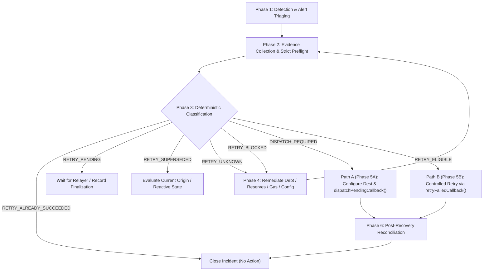

# CrossGuard Cross-Chain Recovery Runbook

**Document Version:** 1.1.0  
**Milestone:** M006.1 — Recovery Preflight Integrity, Durable Event Dispatch & Cross-Chain Failure Reconciliation  
**Target Topology:**  
- **Origin Chain:** Base Sepolia (`84532`)  
- **Reactive Engine:** Reactive Lasna (`5318007`)  
- **Destination Chain:** Unichain Sepolia (`1301`)  
**Scope:** Standard Operating Procedure (SOP) for Incident Response, Fail-Closed Preflight Diagnosis, Deferred Dispatch Recovery (`DISPATCH_REQUIRED`), and Controlled Same-Nonce Retry (`RETRY_ELIGIBLE`)  

---

## 1. Operational Overview & Safety Boundaries

CrossGuard automates cross-chain borrowing risk pauses by monitoring origin events on Base Sepolia and executing authenticated callbacks on Unichain Sepolia via Reactive Lasna. Under M006.1:
- **Durable Pending Dispatch (Path A):** If a valid origin event (`RiskBreach` or `RiskResolved`) arrives while `CrossGuardReactive` has an incomplete destination configuration (for example, Stage-1 deployment prior to running `ConfigureReactive.s.sol`), `CrossGuardReactive.react()` stores the payload with `DispatchStatus.PENDING_DISPATCH` and emits `CallbackDispatchDeferred` instead of losing the state update. Once configuration is complete, the owner invokes `dispatchPendingCallback(positionId, expectedNonce)` with zero retry quota consumed (`retryCount == 0`).
- **Controlled Same-Nonce Retry (Path B):** If a previously submitted callback (`DispatchStatus.REQUESTED`) fails on the destination chain due to EVM revert, destination gas exhaustion, or Callback Proxy funding/debt issues, the owner invokes `retryFailedCallback(positionId, expectedNonce, reasonCode)` once the underlying root cause is fixed.

### Core Operational Principles & Hard Policy Boundaries
1. **Never Diagnose or Recover Without Strict Preflight:** Always run `--recovery-preflight` supplying all three mandatory arguments: `--position-id`, `--expected-nonce`, and `--reactive-tx-hash`. Missing any argument fails closed with `RETRY_UNKNOWN` and non-zero exit code.
2. **Never Confuse Deferred Dispatch With Delivery Failure:** Never call `retryFailedCallback()` for a `DISPATCH_REQUIRED` position (`DispatchStatus.PENDING_DISPATCH`); `CrossGuardReactive` enforces `CallbackNotRequested()` and requires `dispatchPendingCallback()`. Conversely, `dispatchPendingCallback()` enforces `DispatchNotPending()` and cannot substitute for `retryFailedCallback()`.
3. **Same-Nonce Principle:** A failed destination callback rolls back destination EVM state, leaving `lastProcessedNonce` unchanged. Retries MUST target the exact stored origin nonce (`expectedNonce == latestCallback.nonce`) and payload. Never advance origin nonces artificially to retry.
4. **Strict Retry Quota:** A maximum of 3 retries (`MAX_RETRIES = 3`) are permitted per `REQUESTED` origin event. Valid newer origin transitions supersede earlier state and reset `retryCount` to `0`.
5. **No Unchecked Automated Mutations:** The `--recovery-preflight` diagnostic tool is strictly read-only. It never broadcasts transactions, never runs automated funding or retry loops, and intentionally keeps `suggested_command = None` (never emitting copy-paste `cast send` commands).
6. **Fail-Closed Debt & Fee Separation:** Always distinguish System Contract debt/reserves (`REACT` on Reactive Lasna `0x8888...8888`) from Callback Proxy debt/reserves (`ETH` on Unichain Sepolia `0x9299...7FC4`). Any missing or malformed fee/RPC parameter must fail closed as `RETRY_UNKNOWN`.
7. **Credential Isolation:** Never expose private keys, seed phrases, or unredacted RPC URLs in logs, terminal output, or incident reports.

---

## 2. Six-Phase Incident Response Procedure



---

### Phase 1: Detection & Alert Triaging
Identify an anomalous or stalled cross-chain state:
- **Symptom A:** An origin position on Base Sepolia has breached its risk threshold (`LTV >= 80%`), but borrowing remains active on Unichain Sepolia.
- **Symptom B:** Reactive Lasna health checker reports `CRITICAL` or `WARNING` status on `callback_record_inspection`.
- **Symptom C:** The routine operational health check reports outstanding debt on the Reactive System Contract or Callback Proxy.

**Initial Triage Action:**
Run the standard read-only operational health check:
```bash
python script/ops/crossguard_healthcheck.py --json
```

---

### Phase 2: Evidence Collection & Strict Preflight Diagnostics
Execute the read-only recovery preflight tool with all three mandatory correlation inputs (`--position-id`, `--expected-nonce`, and `--reactive-tx-hash`):
```bash
python script/ops/crossguard_healthcheck.py \
  --recovery-preflight \
  --position-id 0x<POSITION_ID_64_HEX_CHARS> \
  --expected-nonce <EXPECTED_NONCE> \
  --reactive-tx-hash 0x<REACTIVE_ORIGINATING_TX_HASH> \
  --safety-multiplier 2
```
*Note: Missing or invalid `--position-id`, `--expected-nonce` ($\ge 1$), or `--reactive-tx-hash` causes the tool to fail closed with `RETRY_UNKNOWN` and exit code `1`. `--safety-multiplier` expects an integer (default: `2`).*

The preflight tool inspects and correlates:
1. **Origin State:** `positionNonce(bytes32)` and `isPositionBreached(bytes32)` on Base Sepolia `RiskController`.
2. **Reactive State:** `latestOriginNonce(bytes32)`, 5-field `getLatestCallback(bytes32)` `(nonce, eventType, payload, retryCount, dispatchStatus)`, and destination config (`destinationChainId`, `destinationCallback`, `callbackGasLimit >= 100_000`) on Reactive Lasna `CrossGuardReactive`.
3. **Destination State:** `lastProcessedNonce(bytes32)`, `isBorrowingPaused(bytes32)`, `pausedByRiskBreach(bytes32)`, and `pausedByAdmin(bytes32)` on Unichain Sepolia `BorrowingController`.
4. **Economics & Fail-Closed Fee Reserves:** Distinct `debt(address)` and `reserves(address)` on the Reactive System Contract (`0x8888...8888`, REACT) and Unichain Callback Proxy (`0x9299...7FC4`, ETH), plus live fee estimation (`_gasPriceCoeffPer1000()`, `_extraGas()`, `_maxChargeGas()`, destination `gas-price` / `base-fee`) verified against `estimated_fee * safety_multiplier`. Missing or unparseable economic fields fail closed as `RETRY_UNKNOWN`.
5. **Receipt & 6-Field Callback Correlation:** Verifies `ReactiveBreachProcessed` / `ReactiveResolvedProcessed` / `CallbackDispatchDeferred` / `CallbackDispatchSubmitted` / `CallbackRetryRequested` and `CallbackRequest` logs in `--reactive-tx-hash` using exact Ethereum Keccak-256 event topics, and unambiguously matches `getCallbacks(uint256)` 6-field tuples (`blockNumber`, `reactiveContract`, `callbackIndex`, `destinationChainId`, `destinationTxHash`, `error`).

> **Read-Only Guarantee:** `--recovery-preflight` keeps `suggested_command = None` across all outcomes and never emits executable `cast send` commands, never triggers auto-funding, and never runs automatic retry loops.

---

### Phase 3: Classification & Root Cause Identification

The preflight tool categorizes recovery eligibility into one of seven deterministic outcomes:

| Classification | Exit Code | Meaning | Required Operator Action |
|---|---|---|---|
| **`DISPATCH_REQUIRED`** | `0` | Valid origin event is stored on Reactive with `DispatchStatus.PENDING_DISPATCH` (event was deferred while destination config was incomplete); `CallbackDispatchDeferred` confirmed. | Follow **Path A (Phase 5A): `dispatchPendingCallback()`** once destination config and reserves are verified. |
| **`RETRY_ELIGIBLE`** | `0` | Destination callback (`REQUESTED`) confirmed failed or rejected (non-empty `error` + nonzero matched `destinationTxHash`), destination nonce unadvanced, `retryCount < 3`, debts `== 0`, reserves adequate, and receipt correlation passed. | Proceed to **Path B (Phase 5B): `retryFailedCallback()`**. |
| **`RETRY_ALREADY_SUCCEEDED`** | `0` | Destination has already processed `expectedNonce` (`lastProcessedNonce >= expectedNonce`) and destination callback confirmed without contradictions. | Do NOT dispatch or retry. Incident is resolved; update monitoring. |
| **`RETRY_PENDING`** | `1` | Callback is `REQUESTED` and either callback records are empty or matched record has zero `destinationTxHash` with empty error (relayer in-flight / unconfirmed). Never inferred as succeeded or failed without evidence. | Do NOT retry yet. Wait 2-5 minutes for relayer finalization and re-run preflight. |
| **`RETRY_SUPERSEDED`** | `1` | Origin `positionNonce` or Reactive `latestOriginNonce` has strictly exceeded `expectedNonce`. | Do NOT dispatch or retry obsolete nonce. Re-run preflight against the latest nonce if still unpaused. |
| **`RETRY_BLOCKED`** | `1` | Recovery cannot proceed due to System Contract or Callback Proxy debt `> 0`, insufficient fee reserves (`net_reserves < estimated_fee * safety_multiplier`), unconfigured destination, `callbackGasLimit < 100_000`, or retry budget exhausted (`retryCount >= 3`). | Proceed to **Phase 4** (Remediation of Root Cause). |
| **`RETRY_UNKNOWN`** | `1` | Missing mandatory input, RPC failure, malformed ABI output, missing/unparseable fee parameter, invalid/missing receipt event correlation, ambiguous multiple callback records, or cross-chain state contradiction. | Resolve connectivity/input/correlation issue before any state mutation. Never retry blindly. |

---

### Phase 4: Remediation of Underlying Cause

Before invoking `dispatchPendingCallback()` or `retryFailedCallback()`, every root cause blocking Phase 3 MUST be resolved manually (cross-chain debts and reserves are strictly tracked separately per chain):

#### Root Cause 1: Destination Unconfigured / Deferred Dispatch (`DISPATCH_REQUIRED` or `RETRY_BLOCKED`)
- **Diagnosis:** Origin event was stored with `DispatchStatus.PENDING_DISPATCH` while `destinationCallback == address(0)` or destination config was invalid.
- **Remediation:** Owner configures destination adapter (`chainId = 1301`, `callbackGasLimit >= 100_000`; `300_000` recommended):
  ```bash
  cast send <CROSSGUARD_REACTIVE_ADDRESS> \
    "setDestinationConfig(uint256,address,uint64)" 1301 <CROSSGUARD_CALLBACK_ADDRESS> 300000 \
    --rpc-url $REACTIVE_LASNA_RPC_URL \
    --private-key $OWNER_PRIVATE_KEY
  ```

#### Root Cause 2: Outstanding System Contract Debt or Insufficient Reactive Reserves (`RETRY_BLOCKED`)
- **Diagnosis:** System Contract `debt(reactiveContract) > 0` on Reactive Lasna (`0x8888...8888`).
- **Remediation:** Deposit native `REACT` funds to the Reactive System Contract on Reactive Lasna (never send funds directly to `CrossGuardReactive.pay()` unless using `depositTo`):
  ```bash
  cast send 0x8888888888888888888888888888888888888888 \
    "depositTo(address)" <CROSSGUARD_REACTIVE_ADDRESS> \
    --value <AMOUNT_WEI> \
    --rpc-url $REACTIVE_LASNA_RPC_URL \
    --private-key $OPERATOR_PRIVATE_KEY
  ```

#### Root Cause 3: Outstanding Callback Proxy Debt or Insufficient Destination Reserves (`RETRY_BLOCKED`)
- **Diagnosis:** Callback Proxy `debt(callbackContract) > 0` OR net proxy reserves are below `estimated_callback_fee_wei * safety_multiplier` on Unichain Sepolia (`0x9299...7FC4`).
- **Remediation:** Deposit native `ETH` to the Callback Proxy on Unichain Sepolia:
  ```bash
  cast send 0x9299472A6399Fd1027ebF067571Eb3e3D7837FC4 \
    "depositTo(address)" <CROSSGUARD_CALLBACK_ADDRESS> \
    --value <AMOUNT_WEI> \
    --rpc-url $UNICHAIN_SEPOLIA_RPC_URL \
    --private-key $OPERATOR_PRIVATE_KEY
  ```

#### Root Cause 4: Insufficient Callback Gas Limit (`RETRY_BLOCKED`)
- **Diagnosis:** `callbackGasLimit < 100_000` (`MIN_CALLBACK_GAS_LIMIT`) or destination out-of-gas revert observed. Note `CrossGuardReactive` rejects any config or dispatch with `callbackGasLimit < 100_000`.
- **Remediation:** Owner updates destination config with `>= 100_000` gas (`300_000` recommended) via `setDestinationConfig(1301, <CROSSGUARD_CALLBACK_ADDRESS>, 300000)`.

#### Root Cause 5: Retry Budget Exhausted (`RETRY_BLOCKED`)
- **Diagnosis:** 3 retries have already been consumed (`retryCount == 3`, `DispatchStatus.REQUESTED`).
- **Remediation:** `retryFailedCallback()` is locked for this nonce. Operator must trigger a fresh risk evaluation on Base Sepolia (`evaluatePositionRisk`) if the risk condition requires a newer nonce, or execute governed emergency intervention on Unichain Sepolia (`emergencyPauseBorrowing` / `emergencyResumeBorrowing`).

---

### Phase 5: Controlled Dispatch or Retry Execution

Re-run Phase 2 `--recovery-preflight` after Phase 4 remediation to confirm either `DISPATCH_REQUIRED` (for Path A) or `RETRY_ELIGIBLE` (for Path B). Do not proceed under `RETRY_BLOCKED`, `RETRY_PENDING`, `RETRY_SUPERSEDED`, `RETRY_ALREADY_SUCCEEDED`, or `RETRY_UNKNOWN`.

#### Path A (Phase 5A): Initial Dispatch for Deferred Pending Callback (`DISPATCH_REQUIRED`)
Use ONLY when `getLatestCallback(positionId)` has `status == PENDING_DISPATCH (1)` and destination config is valid:
- Calls `dispatchPendingCallback(bytes32 positionId, uint256 expectedNonce)` as `onlyOwner`.
- Sets `status = REQUESTED (2)`, emits `CallbackDispatchSubmitted`, requests the Omni callback, and preserves `retryCount == 0` (does NOT burn any retry quota).
- Requires operator manual invocation (`--recovery-preflight` never outputs a copy-paste `cast send` command):
  - Contract: `<CROSSGUARD_REACTIVE_ADDRESS>` on Reactive Lasna (`5318007`)
  - Signature: `dispatchPendingCallback(bytes32,uint256)` with `<POSITION_ID>` and `<EXPECTED_NONCE>`

#### Path B (Phase 5B): Controlled Retry for Confirmed Delivery Failure (`RETRY_ELIGIBLE`)
Use ONLY when `getLatestCallback(positionId)` has `status == REQUESTED (2)`, `retryCount < 3`, and destination delivery failure is confirmed:
- Calls `retryFailedCallback(bytes32 positionId, uint256 expectedNonce, bytes32 reasonCode)` as `onlyOwner`.
- Increments `retryCount`, emits `CallbackRetryRequested(positionId, expectedNonce, retryAttempt, reasonCode)`, and re-requests the exact stored payload.
- Requires operator manual invocation (`--recovery-preflight` never outputs a copy-paste `cast send` command):
  - Contract: `<CROSSGUARD_REACTIVE_ADDRESS>` on Reactive Lasna (`5318007`)
  - Signature: `retryFailedCallback(bytes32,uint256,bytes32)` with `<POSITION_ID>`, `<EXPECTED_NONCE>`, and one of the standardized `bytes32 reasonCode` constants below.

#### Standard Supported Reason Codes (`bytes32` for Path B `retryFailedCallback`):

| Reason Code String | Hex Representation (`bytes32`) | Description |
|---|---|---|
| `RECOVERY_GAS_EXHAUSTION` | `0x5245434f564552595f4741535f45584841555354494f4e000000000000000000` | Prior callback failed due to destination out-of-gas. Gas limit was increased. |
| `RECOVERY_DESTINATION_REVERT` | `0x5245434f564552595f44455354494e4154494f4e5f5245564552540000000000` | Destination execution reverted due to transient logic or dependency failure. |
| `RECOVERY_PROXY_DEBT_CLEARED` | `0x5245434f564552595f50524f58595f444542545f434c45415245440000000000` | Callback was held due to proxy debt or insufficient reserves. Reserves replenished via `depositTo()`. |
| `RECOVERY_RELAY_TIMEOUT` | `0x5245434f564552595f52454c41595f54494d454f555400000000000000000000` | Relayer failed to deliver transaction within SLA window; re-requesting dispatch. |
| `RECOVERY_CONFIG_CORRECTED` | `0x5245434f564552595f434f4e4649475f434f5252454354454400000000000000` | Destination adapter or chain ID was misconfigured and has been updated. |

---

### Phase 6: Post-Recovery Reconciliation & Verification

1. **Verify Reactive Event Emission:**
   - **Path A:** Confirm `CallbackDispatchSubmitted(bytes32 indexed positionId, uint256 indexed nonce, CallbackType indexed eventType)` and Omni `CallbackRequest` were emitted, and `getLatestCallback(positionId).status == REQUESTED (2)` with `retryCount == 0`.
   - **Path B:** Confirm `CallbackRetryRequested(bytes32 indexed positionId, uint256 indexed nonce, uint8 retryAttempt, bytes32 reasonCode)` and Omni `CallbackRequest` were emitted.
2. **Verify Destination State Synchronization:**
   Query destination `BorrowingController` on Unichain Sepolia:
   ```bash
   cast call <BORROWING_CONTROLLER_ADDRESS> "lastProcessedNonce(bytes32)(uint256)" <POSITION_ID> --rpc-url $UNICHAIN_SEPOLIA_RPC_URL
   cast call <BORROWING_CONTROLLER_ADDRESS> "isBorrowingPaused(bytes32)(bool)" <POSITION_ID> --rpc-url $UNICHAIN_SEPOLIA_RPC_URL
   ```
   - `lastProcessedNonce` must equal `<EXPECTED_NONCE>` (or higher if a newer origin transition occurred).
   - `isBorrowingPaused` must match the intended risk state (or remain `true` if `pausedByAdmin` is set).
3. **Run Final Preflight Verification:**
   Re-running `--recovery-preflight` against `--position-id`, `--expected-nonce`, and the new reactive transaction hash should report `RETRY_ALREADY_SUCCEEDED` (or `RETRY_SUPERSEDED` if a newer event already arrived).
4. **Log Incident Report:** Record position ID, expected nonce, path taken (Path A `dispatchPendingCallback` vs Path B `retryFailedCallback`), reason code (if Path B), redacted telemetry, and both Reactive and Destination transaction hashes.
