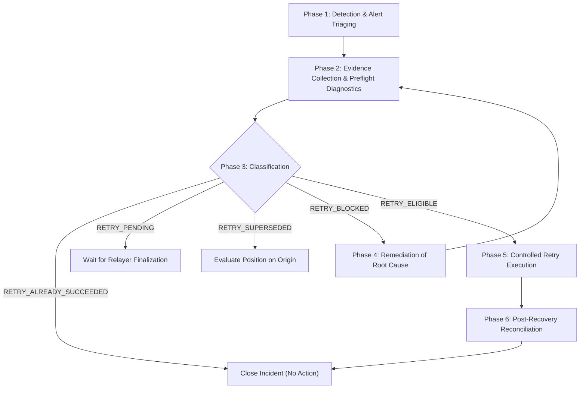

# CrossGuard Cross-Chain Recovery Runbook

**Document Version:** 1.0.0  
**Milestone:** M006 — Controlled Callback Recovery & Cross-Chain Reconciliation  
**Target Topology:**  
- **Origin Chain:** Base Sepolia (`84532`)  
- **Reactive Engine:** Reactive Lasna (`5318007`)  
- **Destination Chain:** Unichain Sepolia (`1301`)  
**Scope:** Standard Operating Procedure (SOP) for Incident Response, Failure Diagnosis, and Controlled Same-Nonce Recovery  

---

## 1. Operational Overview & Safety Boundaries

CrossGuard automates cross-chain borrowing risk pauses by monitoring origin events on Base Sepolia and executing authenticated callbacks on Unichain Sepolia via Reactive Lasna. If an external relay timeout, destination gas exhaustion, or proxy debt halts callback execution, the protocol provides an owner-authorized, rate-limited same-nonce retry mechanism in `CrossGuardReactive.sol`.

### Core Operational Principles
1. **Never Retry Blindly:** Always execute the read-only preflight diagnostic tool (`--recovery-preflight`) before triggering on-chain transactions.
2. **Same-Nonce Principle:** A failed destination callback rolls back destination EVM state, leaving `lastProcessedNonce` unchanged. Retries MUST use the exact same origin nonce and payload. Never increment nonces for retries.
3. **Strict Retry Quota:** A maximum of 3 retries are permitted per origin event (`MAX_RETRIES = 3`). Unnecessary retries consume the budget and risk locking the position in an un-retryable state until a new origin event occurs.
4. **Credential Isolation:** Never paste private keys, seed phrases, or unredacted RPC endpoints into diagnostic scripts or shared incident channels.

---

## 2. Six-Phase Incident Response Procedure



---

### Phase 1: Detection & Alert Triaging
Identify an anomalous or stalled cross-chain state:
- **Symptom A:** An origin position on Base Sepolia has breached its risk threshold (`LTV >= 80%`), but borrowing remains active on Unichain Sepolia.
- **Symptom B:** Reactive Lasna health checker reports `CRITICAL` or `WARNING` status on `callback_record_inspection`.
- **Symptom C:** The routine operational health check reports outstanding debt on the Reactive System Contract or Callback Proxy.

**Initial Triage Action:**
Run the standard read-only operational health check:
```bash
python script/ops/crossguard_healthcheck.py --json
```

---

### Phase 2: Evidence Collection & Preflight Diagnostics
Execute the read-only recovery preflight tool against the specific position:
```bash
python script/ops/crossguard_healthcheck.py \
  --recovery-preflight \
  --position-id 0x<POSITION_ID_64_HEX_CHARS> \
  --reactive-tx-hash 0x<REACTIVE_ORIGINATING_TX_HASH>
```

The preflight tool inspects:
1. **Origin State:** `positionNonce(bytes32)` and `isPositionBreached(bytes32)` on Base Sepolia `RiskController`.
2. **Reactive State:** `latestOriginNonce(bytes32)`, `getLatestCallback(bytes32)`, and destination config on Reactive Lasna `CrossGuardReactive`.
3. **Destination State:** `lastProcessedNonce(bytes32)`, `isBorrowingPaused(bytes32)`, and pause flags on Unichain Sepolia `BorrowingController`.
4. **Economics:** `debt(address)` and `reserves(address)` on both the System Contract (`0x8888...8888`) and Callback Proxy (`0x9299...7FC4`).
5. **Callback Records:** Exact execution status and destination revert reason from `getCallbacks(uint256)`.

---

### Phase 3: Classification & Root Cause Identification

The preflight tool categorizes the recovery status into one of six deterministic outcomes:

| Classification | Meaning | Required Operator Action |
|---|---|---|
| **`RETRY_ELIGIBLE`** | Destination callback failed or was dropped; preflight checks pass; budget available ($< 3$). | Proceed to **Phase 5** (Controlled Retry Execution). |
| **`RETRY_ALREADY_SUCCEEDED`** | Destination has already processed this nonce or callback transaction confirmed. | Do NOT retry. Incident is already resolved; update monitoring. |
| **`RETRY_PENDING`** | Callback is recorded on Reactive Lasna but pending delivery by relayer (`destinationTxHash == 0`). | Do NOT retry yet. Wait 2-5 minutes for relayer processing. |
| **`RETRY_SUPERSEDED`** | A newer origin evaluation has already advanced the nonce on Base Sepolia. | Do NOT retry obsolete nonce. Evaluate position on origin if state needs refreshing. |
| **`RETRY_BLOCKED`** | Recovery cannot succeed due to debt, exhausted retries, or misconfiguration. | Proceed to **Phase 4** (Remediation of Root Cause). |
| **`RETRY_UNKNOWN`** | RPC query failure or invalid input parameters. | Check RPC endpoints, network reachability, and position ID syntax. |

---

### Phase 4: Remediation of Underlying Cause

Before invoking `retryFailedCallback()`, the root cause identified in Phase 3 MUST be rectified:

#### Root Cause 1: Outstanding Debt on System Contract (`RETRY_BLOCKED`)
- **Diagnosis:** System Contract `debt(reactiveContract) > 0`.
- **Remediation:** Deposit native funds (`REACT`) on Reactive Lasna:
  ```bash
  cast send 0x8888888888888888888888888888888888888888 \
    "depositTo(address)" <CROSSGUARD_REACTIVE_ADDRESS> \
    --value <AMOUNT_WEI> \
    --rpc-url $REACTIVE_LASNA_RPC_URL \
    --private-key $OPERATOR_PRIVATE_KEY
  ```

#### Root Cause 2: Outstanding Debt on Callback Proxy (`RETRY_BLOCKED`)
- **Diagnosis:** Callback Proxy `debt(callbackContract) > 0` on Unichain Sepolia.
- **Remediation:** Deposit native gas token (`ETH`) to the Callback Proxy on Unichain Sepolia:
  ```bash
  cast send 0x9299472A6399Fd1027ebF067571Eb3e3D7837FC4 \
    "depositTo(address)" <CROSSGUARD_CALLBACK_ADDRESS> \
    --value <AMOUNT_WEI> \
    --rpc-url $UNICHAIN_SEPOLIA_RPC_URL \
    --private-key $OPERATOR_PRIVATE_KEY
  ```

#### Root Cause 3: Insufficient Callback Gas Limit (`RETRY_BLOCKED`)
- **Diagnosis:** `callbackGasLimit` is below the required 100,000 minimum or destination out-of-gas occurred.
- **Remediation:** Owner updates destination config with 300,000 gas limit:
  ```bash
  cast send <CROSSGUARD_REACTIVE_ADDRESS> \
    "setDestinationConfig(uint256,address,uint64)" 1301 <CROSSGUARD_CALLBACK_ADDRESS> 300000 \
    --rpc-url $REACTIVE_LASNA_RPC_URL \
    --private-key $OWNER_PRIVATE_KEY
  ```

#### Root Cause 4: Retry Budget Exhausted (`RETRY_BLOCKED`)
- **Diagnosis:** 3 retries have already been consumed (`retryCount == 3`).
- **Remediation:** Automated retry is locked. Operator must trigger a fresh risk evaluation on Base Sepolia (`evaluatePositionRisk`) to advance the origin nonce and reset the retry budget, or manually coordinate an emergency administrative override on Unichain Sepolia.

---

### Phase 5: Controlled Retry Execution

Once Phase 4 remediation is complete, re-run Phase 2 preflight to confirm `RETRY_ELIGIBLE`.

Execute `retryFailedCallback()` from the designated contract owner account on Reactive Lasna, passing the standardized `bytes32 reasonCode`:

```bash
cast send <CROSSGUARD_REACTIVE_ADDRESS> \
  "retryFailedCallback(bytes32,uint256,bytes32)" \
  <POSITION_ID> \
  <EXPECTED_NONCE> \
  <REASON_CODE_BYTES32> \
  --rpc-url $REACTIVE_LASNA_RPC_URL \
  --private-key $OWNER_PRIVATE_KEY
```

#### Standard Supported Reason Codes (`bytes32`):

| Reason Code String | Hex Representation (`bytes32`) | Description |
|---|---|---|
| `RECOVERY_GAS_EXHAUSTION` | `0x5245434f564552595f4741535f45584841555354494f4e000000000000000000` | Prior callback failed due to destination out-of-gas. Gas limit was increased. |
| `RECOVERY_DESTINATION_REVERT` | `0x5245434f564552595f44455354494e4154494f4e5f5245564552540000000000` | Destination execution reverted due to transient logic or dependency failure. |
| `RECOVERY_PROXY_DEBT_CLEARED` | `0x5245434f564552595f50524f58595f444542545f434c45415245440000000000` | Callback was held due to proxy debt. Debt has been settled via `depositTo()`. |
| `RECOVERY_RELAY_TIMEOUT` | `0x5245434f564552595f52454c41595f54494d454f555400000000000000000000` | Relayer failed to submit transaction within SLA window; re-requesting dispatch. |
| `RECOVERY_CONFIG_CORRECTED` | `0x5245434f564552595f434f4e4649475f434f5252454354454400000000000000` | Destination adapter or chain ID was misconfigured and has been updated. |

---

### Phase 6: Post-Recovery Reconciliation & Verification

1. **Verify Reactive Event Emission:**
   Confirm `CallbackRetryRequested(bytes32 indexed positionId, uint256 indexed nonce, uint8 retryAttempt, bytes32 reasonCode)` was emitted in the transaction receipt.
2. **Verify Destination State Synchronization:**
   Query destination borrowing controller on Unichain Sepolia:
   ```bash
   cast call <BORROWING_CONTROLLER_ADDRESS> "lastProcessedNonce(bytes32)(uint256)" <POSITION_ID> --rpc-url $UNICHAIN_SEPOLIA_RPC_URL
   cast call <BORROWING_CONTROLLER_ADDRESS> "isBorrowingPaused(bytes32)(bool)" <POSITION_ID> --rpc-url $UNICHAIN_SEPOLIA_RPC_URL
   ```
   - `lastProcessedNonce` must match `<EXPECTED_NONCE>`.
   - `isBorrowingPaused` must reflect the intended risk status (e.g., `true` for breach recovery).
3. **Run Final Preflight Verification:**
   Re-running `--recovery-preflight` should now return `RETRY_ALREADY_SUCCEEDED`.
4. **Log Incident Report:** Document position ID, origin nonce, retry attempt number, reason code, and tx hashes in the protocol incident log.
