# M007.1 — Cross-Chain Identity & Position Authorization Threat Model

**Document Version:** 1.0.0
**Milestone:** M007.1 — Cross-Chain Identity & Position Authorization Security
**Repository:** `mahitss/Cross-Chain-Risk-Response-`
**Working Branch:** `security/m007-1-cross-chain-identity`
**Baseline Origin:** Merged PR #3 (`origin/main` @ `88cf74fdf681ebf5c29f8248138689459b881892`)
**Topology:**
- **Origin Chain:** Base Sepolia (`84532`)
- **Reactive Engine:** Reactive Lasna (`5318007`)
- **Destination Chain:** Unichain Sepolia (`1301`)

---

## 1. Executive Summary

Prior to Mission M007.1, `PositionID` was an unconstrained caller-supplied `bytes32` value on Origin (`CollateralVault`) and an unauthenticated first-come-first-served key on Destination (`BorrowingController.registerPosition(bytes32)` / owner-supplied `registerPositionFor(bytes32,address)`). That permitted position squatting, arbitrary ID pre-claiming, unverified origin vault identity across chains, and ambiguous correlation between origin position owners (`msg.sender` on Base Sepolia) and destination borrowers (`positionOwners` on Unichain Sepolia).

M007.1 eliminates those trust-boundary weaknesses across all five core contracts, the deployment scripts, and the read-only operational healthcheck/preflight tool by enforcing one unified, domain-separated, cryptographically derived identity root (`CrossGuardIdentity.sol`):

$$\text{PositionID} = \text{keccak256}\big(\text{abi.encode}(\text{POSITION\_IDENTITY\_DOMAIN}, \text{originChainId}, \text{originRiskController}, \text{originVault}, \text{originUser}, \text{salt})\big)$$

where $\text{POSITION\_IDENTITY\_DOMAIN} = \text{keccak256}(\texttt{"CROSSGUARD\_POSITION\_IDENTITY\_V1"})$ and $\text{IDENTITY\_VERSION} = 1$.

---

## 2. End-to-End Identity Verification Flow

```mermaid
flowchart LR
    User["Origin User (Base Sepolia)"] -->|"openPosition(salt, asset, amount)"| Vault["CollateralVault (84532)"]
    Vault -->|"registerPositionIdentity(posId, user, salt)"| RC["RiskController (84532)"]
    RC -->|"192B RiskBreach / RiskResolved (version=1, vault, salt)"| Sys["Reactive System Contract (5318007)"]
    Sys -->|"react(LogRecord)"| React["CrossGuardReactive (5318007)"]
    React -->|"requestCallbackV_1_0(RiskCallbackMessage)"| Proxy["Callback Proxy (1301)"]
    Proxy -->|"inject reactiveSender"| CB["CrossGuardCallback (1301)"]
    CB -->|"pauseBorrowing / resolveBorrowing(RiskCallbackMessage)"| BC["BorrowingController (1301)"]
    User -->|"registerPosition(salt) OR EIP-712 / ERC-1271 auth"| BC
```

---

## 3. Trust Boundaries & Layer-by-Layer Enforcement

| Layer | Contract / Tool | Identity & Authorization Invariants Enforced |
|---|---|---|
| **Shared Derivation** | `src/libraries/CrossGuardIdentity.sol` | Enforces `originChainId != 0`, `originRiskController != address(0)`, `originVault != address(0)`, `originUser != address(0)`, `salt != bytes32(0)`, `IDENTITY_VERSION == 1`. |
| **Origin Vault** | `src/origin/CollateralVault.sol` | New positions require `openPosition(salt, asset, amount)` binding `pos.user = msg.sender` and `_positionIdentities[posId]`. `depositCollateral` and `recordBorrow` revert with `PositionNotInitialized` on uncreated IDs and `UnauthorizedUser` for any caller `!= pos.user` (no owner bypass). Preserves `_positions` storage layout slot `2`. |
| **Origin Policy** | `src/origin/RiskController.sol` | `registerPositionIdentity` and `assessRisk` are strictly gated by `onlyAuthorizedVault` (`owner()` cannot bypass). Enforces immutable one-time identity binding, `id.originVault == msg.sender` (`VaultIdentityMismatch`), `id.originUser == user` (`OriginUserMismatch`), and canonical preimage check (`PositionIdMismatch`). Emits 192-byte versioned events (`IDENTITY_VERSION`, `originVault`, `salt`, `ltvBps`, `thresholdBps`, `timestamp`). |
| **Reactive Engine** | `src/reactive/CrossGuardReactive.sol` | Stores immutable/configured `originChainId`, `originRiskController`, `originCollateralVault`. `react()` rejects non-system callers, wrong chains/emitters, legacy 96-byte logs (`INVALID_DATA_LENGTH`), dirty upper bits on `identityVersion`/`originVault`/`originUser` (`MALFORMED_EVENT_DATA`), `version != 1` (`UNSUPPORTED_IDENTITY_VERSION`), `evVault != originCollateralVault` (`UNAUTHORIZED_ORIGIN_VAULT`), zero `salt` (`INVALID_SALT`), and `tryComputePositionId != positionId` (`POSITION_ID_MISMATCH`). Encodes full `RiskCallbackMessage` payloads. |
| **Callback Adapter** | `src/destination/CrossGuardCallback.sol` | Validates `authorizedSenderOnly` (`callbackProxy`), `reactiveSender == authorizedReactiveSender` (strictly distinct from `message.originUser`), `identityVersion == 1`, `positionId != 0`, and `computePositionId == message.positionId` before forwarding. |
| **Destination Lending** | `src/destination/BorrowingController.sol` | Binds immutable `trustedOriginChainId` (`84532`), `trustedOriginRiskController`, and `trustedOriginVault`. Removes arbitrary `registerPosition(bytes32)` and `registerPositionFor(bytes32,address)`. Supports same-wallet `registerPosition(bytes32 salt)` (`originUser == msg.sender == destinationOwner`) and relayer-submittable `registerPositionWithAuthorization(...)` with EIP-712 (`name="CrossGuardBorrowingController", version="1"`) + `SignatureChecker` (EOA ECDSA + ERC-1271), monotonic `sigNonces[originUser]`, and `deadline`. |
| **Ops & Preflight** | `script/ops/crossguard_healthcheck.py` | Requires `--origin-collateral-vault` (`BASE_COLLATERAL_VAULT`). Verifies `Origin CollateralVault` bytecode, `CollateralVault.riskController()`, `RiskController.authorizedVaults(vault)`, `CrossGuardReactive.originCollateralVault()`, and `BorrowingController.trustedOriginChainId/RiskController/Vault`. Fails closed (`RETRY_UNKNOWN` / `RETRY_BLOCKED` / `CRITICAL`). |

---

## 4. Default-Owner Policy Semantics

Cross-chain risk events may arrive on Unichain Sepolia before a user has explicitly registered on the destination lending pool:

1. **Explicit Registration First (`registerPosition(salt)` or `registerPositionWithAuthorization(...)`):**
   - Binds `originUsers[posId]`, `originIdentityHashes[posId] == posId`, `positionIdentityVersion[posId] == 1`, and `positionOwners[posId] = destinationOwner`.
   - Subsequent `RiskBreach` or `RiskResolved` callbacks strictly verify exact canonical identity match (`PositionIdentityConflict` on any discrepancy) and **never overwrite** `positionOwners[posId]` (`destSmartWallet` remains preserved across breaches, recoveries, and admin interventions).
2. **`RiskBreach` Arriving Before Registration (`pauseBorrowing`):**
   - Verifies canonical identity & `trustedOrigin*` anchors, initializes `originUsers[posId] = message.originUser`, `originIdentityHashes[posId] = posId`, `positionIdentityVersion[posId] = 1`, defaults `positionOwners[posId] = message.originUser`, and engages `pausedByRiskBreach[posId] = true` / `isBorrowingPaused[posId] = true`.
3. **`RiskResolved` Arriving Before Registration (`resolveBorrowing`):**
   - Verifies canonical identity & `trustedOrigin*` anchors, initializes origin identity metadata (`originUsers`, `originIdentityHashes`, `positionIdentityVersion`), advances `lastProcessedNonce[posId]`, and deliberately leaves **`positionOwners[posId] == address(0)`**.
   - A resolution callback **can never grant destination borrowing ownership**. Attempting `borrow()` reverts with `UnregisteredPosition` until the true `originUser` completes `registerPosition(salt)` or `registerPositionWithAuthorization(...)` (or an authenticated `RiskBreach` establishes default `originUser` ownership).

---

## 5. Comprehensive Section 15 Attack Path Matrix (18 Adversarial Vectors)

| # | Attack / Failure Vector | Mitigation Control | Verification Test(s) |
|---|---|---|---|
| **1** | **Destination Position Squatting Before User Arrives** | Canonical `PositionID` binds `originUser`; `registerPosition(salt)` uses `msg.sender`; legacy `registerPosition(bytes32)` & `registerPositionFor` removed. Attacker calling `registerPosition(victimSalt)` derives `computePositionId(attacker, salt) != victimPosId`. | `testDestinationSameWalletRegistrationPreventsSquatting`, `BorrowingController.t.sol` |
| **2** | **Origin Front-Running / Arbitrary ID Creation** | `openPosition(salt, asset, amount)` computes `PositionID` from `msg.sender`; `depositCollateral` & `recordBorrow` revert with `PositionNotInitialized` on arbitrary IDs. | `testOriginFrontRunningAndPositionSquattingPrevented`, `testOriginLegacyDepositAndBorrowCannotInitializeArbitraryId` |
| **3** | **Unauthorized Vault / Owner Bypass in `RiskController`** | `onlyAuthorizedVault` enforced with zero owner bypass (`owner()` reverts `UnauthorizedVault`); `VaultIdentityMismatch` prevents authorized vault B from assessing vault A's positions; `OriginUserMismatch` blocks user spoofing. | `testRiskControllerRejectsUnauthorizedCallerEvenOwner`, `testRiskControllerEnforcesOriginVaultAndUserIdentityBinding` |
| **4** | **Unauthorized Origin Vault Event Injection into Reactive** | `CrossGuardReactive` binds `originCollateralVault` (`!= address(0)`) and rejects event `originVault != originCollateralVault` with `UNAUTHORIZED_ORIGIN_VAULT`. | `testReactiveRejectsSpoofedOriginVaultVersionUpperBitsSaltAndIdentityMismatch`, `invariant_ReactiveRejectsSpoofedVaultsAndIdentityMismatch` |
| **5** | **Callback Identity Substitution (`originChainId` / `originRiskController` / `originVault` / `positionId`)** | `CrossGuardCallback` recomputes canonical ID; `BorrowingController` checks immutable `trustedOriginChainId`, `trustedOriginRiskController`, `trustedOriginVault` (`UntrustedOriginDomain`) and preimage (`PositionIdMismatch`). | `testCallbackAndDestinationRejectIdentitySubstitutionAndForgedSender`, `M007IdentityHandler::injectSpoofedIdentityLogs` |
| **6** | **Reactive `originUser` vs Injected `reactiveSender` Confusion** | `CrossGuardCallback` enforces `reactiveSender == authorizedReactiveSender` (deployed Lasna contract) and uses `message.originUser` exclusively for user identity. Injecting `alice` as `rvmId` reverts `UnauthorizedReactiveSender`. | `testCallbackAndDestinationRejectIdentitySubstitutionAndForgedSender`, `CrossGuardCallback.t.sol` |
| **7** | **EIP-712 Signature Replay (Same Position or Across Salts)** | Per-user `sigNonces[identity.originUser]` included in `AuthorizePosition` struct hash and incremented strictly on consumption. | `testEip712ReplayExpiredWrongSignerOwnerSubstitutionDomainAndMalleability`, `invariant_SigNoncesStrictlyMonotonicAndSingleUse` |
| **8** | **Expired EIP-712 Authorization Replay** | `if (block.timestamp > deadline) revert AuthorizationExpired(...)` verified on entry. | `testEip712ReplayExpiredWrongSignerOwnerSubstitutionDomainAndMalleability` |
| **9** | **Forged / Wrong-Signer EIP-712 Authorization** | `SignatureChecker.isValidSignatureNow(identity.originUser, digest, signature)` rejects non-matching EOAs (`InvalidAuthorizationSignature`). | `testEip712ReplayExpiredWrongSignerOwnerSubstitutionDomainAndMalleability`, `M007IdentityHandler::registerDelegatedWithEip712` |
| **10** | **Relayer Destination-Owner Substitution Attack** | `destinationOwner` is bound directly in `AUTHORIZE_POSITION_TYPEHASH` EIP-712 digest; relayer submitting a different `destinationOwner` fails signature verification. | `testEip712DelegatedRegistrationViaRelayerAndBorrowingIsolation`, `testEip712ReplayExpiredWrongSignerOwnerSubstitutionDomainAndMalleability` |
| **11** | **Cross-Chain & Cross-Contract EIP-712 Domain Replay** | OZ `EIP712("CrossGuardBorrowingController", "1")` binds `block.chainid` and `address(this)`. | `testEip712ReplayExpiredWrongSignerOwnerSubstitutionDomainAndMalleability` |
| **12** | **ECDSA High-`s` Malleability & ERC-1271 Invalid Contract Signatures** | OZ `SignatureChecker` rejects high-`s` ECDSA signatures (`ECDSA` strict lower-`s` check) and supports `IERC1271.isValidSignature` returning `0x1626ba7e` (rejecting invalid magic values). | `testEip712ReplayExpiredWrongSignerOwnerSubstitutionDomainAndMalleability`, `testErc1271SmartContractWalletDelegatedRegistration` |
| **13** | **Legacy 96-Byte Events & Dirty Upper-Bit ABI Words** | `CrossGuardReactive.react()` checks `log.data.length == 192` (`INVALID_DATA_LENGTH`) and `calldataload` clean upper bits on `version` (uint8), `originVault` (address), and `topic_2` (`originUser`). | `testReactiveRejectsSpoofedOriginVaultVersionUpperBitsSaltAndIdentityMismatch`, `CrossGuardReactive.t.sol` |
| **14** | **Unregistered `RiskResolved` Ownership Hijacking** | `resolveBorrowing` initializes origin metadata on unregistered positions with `allowDefaultOwnerBinding = false`, keeping `positionOwners == address(0)` until explicit user registration or breach. | `testDefaultOwnerPolicyBreachBeforeRegistrationVsResolvedBeforeRegistration`, `invariant_UnregisteredRiskResolvedNeverGrantsOwnership` |
| **15** | **Cross-Wallet Delegated Owner Clobbering on Breach/Recovery** | `_reconcileCallbackIdentity` leaves `positionOwners` intact whenever non-zero (`destSmartWallet` preserved across breach, retry, resolution, and admin overrides). | `testDefaultOwnerPolicyBreachBeforeRegistrationVsResolvedBeforeRegistration`, `CrossGuardE2E.t.sol`, `invariant_CrossWalletDelegatedOwnershipPreservedAcrossBreachAndRecovery` |
| **16** | **Zero Salt (`bytes32(0)`) / Zero `PositionID` State Injection** | `CrossGuardIdentity` rejects zero salt (`InvalidSalt`), zero addresses (`ZeroAddress`), zero chain ID (`InvalidOriginChainId`); all state mutations reject `bytes32(0)`. | `testOriginRejectsZeroSaltAndDuplicatePositionId`, `testReactiveRejectsSpoofedOriginVaultVersionUpperBitsSaltAndIdentityMismatch` |
| **17** | **Storage Slot Corruption in `CollateralVault`** | `_positionIdentities` appended after `_positions`, keeping `_positions` untouched at storage slot `2`. | `CollateralVault.t.sol::testRevertBorrowWhenZeroCollateral` |
| **18** | **Operational / Preflight Blindness to Missing or Mismatched Vault/Domain** | `crossguard_healthcheck.py` requires `BASE_COLLATERAL_VAULT`, checks vault bytecode, `CollateralVault.riskController()`, `RiskController.authorizedVaults(vault)`, `originCollateralVault()`, and `BorrowingController.trustedOrigin*`. | `test_111`–`test_115` in `test/ops/test_crossguard_healthcheck.py`, `ScriptPreflight.t.sol` |

---

## 6. M007.1 Stateful Security Invariants (All 10 Enforced Across 128,000 Calls)

Verified in `test/unit/M007IdentitySecurity.t.sol:M007IdentityInvariantTest` (256 runs, 128,000 calls, 0 reverts across 9 bounded multi-chain actors/handlers):

| Invariant ID | Invariant Function Name | Security Guarantee |
|---|---|---|
| **ID-INV-01** | `invariant_PositionOwnersBindCanonicalOriginIdentity` | Every non-zero `positionOwners[posId]` has `positionIdentityVersion == 1`, `originUsers != address(0)`, `originIdentityHashes == posId`, and exact canonical preimage parity. |
| **ID-INV-02** | `invariant_OriginUserAndIdentityImmutableOnceInitialized` | Once initialized on Origin or Destination, `originUsers`, `originIdentityHashes`, `positionIdentityVersion`, and `RiskController.getPositionIdentity(posId)` never mutate. |
| **ID-INV-03** | `invariant_NoUnauthorizedOwnerOverwrite` | Once `positionOwners[posId] != address(0)`, it never changes to another address or resets to `address(0)`. |
| **ID-INV-04** | `invariant_UnregisteredRiskResolvedNeverGrantsOwnership` | Positions receiving only `RiskResolved` (no explicit registration and no `RiskBreach`) strictly maintain `positionOwners[posId] == address(0)`. |
| **ID-INV-05** | `invariant_SigNoncesStrictlyMonotonicAndSingleUse` | Per-user `sigNonces` never decrease and consumed authorizations are permanently single-use. |
| **ID-INV-06** | `invariant_NoUnauthorizedBorrowing` | `BorrowingController.borrow()` succeeds strictly when caller `== positionOwners[posId]`, `positionIdentityVersion == 1`, and `!isBorrowingPaused[posId]`. |
| **ID-INV-07** | `invariant_OriginVaultAndControllerDomainParity` | Cross-chain immutable/configured anchors stay strictly consistent across `CollateralVault`, `RiskController`, `CrossGuardReactive`, and `BorrowingController`. |
| **ID-INV-08** | `invariant_ReactiveRejectsSpoofedVaultsAndIdentityMismatch` | Injecting spoofed `originVault`, unsupported version, or mismatched `positionId` never advances `latestOriginNonce` or dispatches callbacks. |
| **ID-INV-09** | `invariant_CrossWalletDelegatedOwnershipPreservedAcrossBreachAndRecovery` | Delegated smart/destination wallets set via EIP-712 / ERC-1271 are preserved untouched across risk breaches, retries, recoveries, and admin pause cycles. |
| **ID-INV-10** | `invariant_RiskAndAdminPauseOrthogonalityWithCanonicalIdentity` | `isBorrowingPaused == (pausedByRiskBreach || pausedByAdmin)` and `lastProcessedNonce` never decreases across all identity-bound transitions. |

---

## 7. Residual Risks & Audit Boundaries

1. **In-Memory Simulation & Offline Mocks Only:** Zero live deployments, zero live transactions, and zero real/testnet RPC broadcasts were performed. Live `SystemContract`, `CallbackProxy`, and cross-chain RPC timing/gas behavior remain outside offline unit verification.
2. **Pre-Audit Prototype Constraints:** `TestValuationSource` remains an owner-controlled mock price oracle; `CollateralVault` tracks single collateral/debt assets per position; owner multisig/timelock governance on `RiskController`, `CrossGuardReactive`, `CrossGuardCallback`, and `BorrowingController` is assumed for production deployments.
3. **Cross-Chain Address Inspection Constraint During Deploy:** On-chain deployment scripts execute on single RPC networks and therefore cannot verify foreign-chain bytecode at deploy time; operators must still run read-only `script/ops/crossguard_healthcheck.py` post-deployment before funding or enabling traffic.
